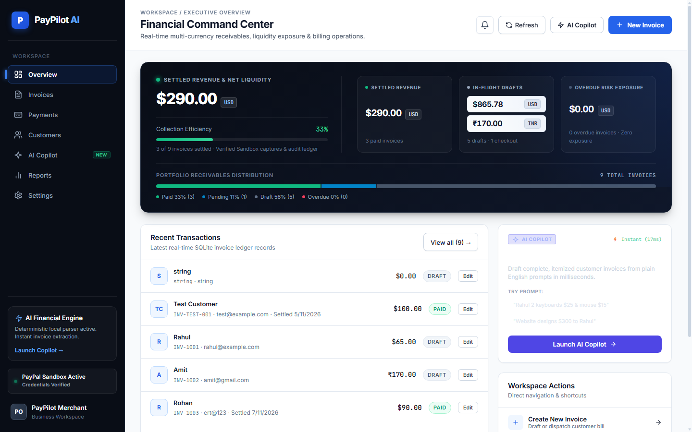

# PayPilot AI

> **Intelligent Invoice & Payment Management Workspace for Freelancers, Agencies, and Small Businesses.**

[](https://www.python.org/)
[](https://fastapi.tiangolo.com/)
[](https://react.dev/)
[](https://vitejs.dev/)
[](https://www.sqlite.org/)
[](https://developer.paypal.com/)

---

## 1. Problem Statement

Small businesses, independent consultants, and agencies face persistent operational friction in billing and accounts receivable:
- **Fragmented Invoicing:** Generating invoices requires repetitive manual entry across disconnected spreadsheets and billing tools.
- **Payment Reconciliation Gaps:** Tracking whether a client actually paid through external gateways often results in manual cross-referencing and bookkeeping discrepancies.
- **Delinquency Blindspots:** Payment deadlines slip past unnoticed due to lack of notification systems for upcoming or overdue invoices.
- **Multi-Currency Complexity:** Operating with global clients in USD, INR, EUR, and GBP frequently introduces rounding drift, uncollected balances, and confusing financial overviews.
- **Opaque Receivables Intelligence:** Business owners lack immediate answers to questions like *"Who owes me money?"* or *"What is my settled versus in-flight revenue?"* without running complex spreadsheet queries.

---

## 2. Solution & How PayPilot AI Works

**PayPilot AI** provides a unified, local-first financial command center that bridges invoice creation, client checkout, ledger auditing, and financial intelligence:

1. **Draft Invoices Instantly:** Merchants create structured multi-item invoices through a clean UI or by typing plain English prompts into the **AI Invoice Generator**.
2. **Collect Payments via PayPal Sandbox:** Invoices can be transitioned to active checkout orders with an instant **"Pay with PayPal"** integration. Clients approve test payments in a secure PayPal Sandbox flow.
3. **Verify and Audit Automatically:** PayPilot AI captures the payment, verifies that the currency and amount match the invoice to the exact cent, locks settled records against tampering, and logs the complete transaction history in a payment audit ledger.
4. **Stay Ahead of Deadlines:** A proactive **Smart Payment Reminders** engine highlights bills that are *Due Today*, *Upcoming (within 3 days)*, or *Overdue*, strictly separating draft worksheets from issued receivables.
5. **Ask Your Financial Copilot:** An offline-safe, deterministic **AI Financial Copilot** provides immediate summaries of portfolio liquidity, overdue exposure, and customer balances.

---

## 3. Key Features

### Invoice Management & Lifecycle Tracking
- Full lifecycle status management: **Draft**, **Pending**, and **Paid**.
- Multi-criteria toolbar: filter by status, search by customer/ID/email, and sort by date, due date, customer name, or value.
- **Audit-Safe Immutability:** Once an invoice is marked `Paid`, the frontend disables editing, while backend API guardrails enforce status, currency, and total amount restrictions.
- **Deletion Protection:** Invoices with linked payment attempts cannot be deleted, ensuring permanent audit history.

### AI Natural-Language Invoice Generator
- Convert unstructured text descriptions into production-ready invoices:
  > *"Bill Apex Dynamics \$1,400 for 14 hours of web design and \$250 for domain registration due next Friday"*
- Deterministic regex and tokenization parser extracts line items, quantities, unit prices, customer names, due dates, and currencies.
- Built-in multi-currency word and symbol recognition (`$`, `€`, `£`, `₹`, USD, EUR, GBP, INR, CAD, AUD).

### PayPal Sandbox Checkout & Payment Capture
- Direct integration with PayPal Orders v2 REST API (`INTENT=CAPTURE`).
- Dynamic origin detection supporting both local machine (`localhost`) and LAN development IPs (e.g. `192.168.x.x`, `10.x.x.x`).
- Short-circuit idempotency preventing duplicate capture attempts.
- Strict order binding ensuring captured PayPal orders match the specific invoice record.

### Payment Audit Ledger & Gateway Guardrails
- Transaction audit ledger tracking every attempt with unique transaction IDs (`PAY-XXXXXX`), timestamps, provider tags, and capture IDs.
- **Gateway Validation Guardrails:** Inspects captured currency and amount against database records. Mismatches (e.g. buyer pays in EUR for a USD invoice) trigger immediate rejection, log a `Failed` status with exact gateway mismatch reasons, and leave the invoice unpaid.
- High-contrast payment status badges clearly distinguishing Completed, Pending, and Failed states.

### Smart Payment Reminders (Notification Center)
- Header bell notification center displaying actionable reminders categorized into:
  - **Overdue:** Issued, unpaid invoices whose due date has passed.
  - **Due Today:** Invoices payable on the current calendar day.
  - **Upcoming Due:** Pending invoices due within the next 1 to 3 calendar days.
- **Accounting Business Rules:** Drafts (unissued worksheets) and Paid invoices are mathematically excluded.
- **Persistence & Synchronization:** Tracks read/unread status persisted in browser `localStorage`. Reminder data recalculates from active invoice records upon navigation, clicking the header Refresh button, or page reload (no active background polling required).
- **Direct Navigation:** 1-click "Open Invoice ->" deep-linking directly into the invoice editor.

### AI Financial Copilot
- Deterministic, local intelligence engine answering natural language questions about the active ledger:
  - *"What is my total revenue?"*
  - *"Which invoices are overdue?"*
  - *"Show me pending checkout orders"*
- Generates structured narratives, status distribution metrics, and actionable navigation shortcuts.
- Fully offline-capable and privacy-preserving; queries are answered locally from SQLite without transmitting financial data to third-party LLMs.

### Customer Directory & Profile Management
- Centralized client database storing customer names, emails, phone numbers, companies, and addresses.
- Detailed customer profile drawer showcasing lifetime spend, invoice history, and multi-currency outstanding receivables.

### Financial Reports & CSV Export
- Interactive reporting suite with dynamic date-range filters (*All Time*, *Last 30 Days*, *Last 90 Days*, *YTD*) and currency filtering.
- Status distribution breakdowns, monthly collection trends, and receivables aging buckets (Current, 1-30 Days Overdue, 30+ Days Overdue).
- Downloadable financial CSV export containing invoice statuses, overdue indicators, payment dates, and PayPal gateway capture references.

### Native Multi-Currency Accounting
- Multi-currency portfolio tracking supporting **USD** and **INR** out of the box, with extensible support for **EUR**, **GBP**, and **CAD**.
- Uses decimal arithmetic (`Decimal('0.01')`) across payment capture verification, invoice validation, and parsing to prevent floating-point representation drift.

---

## 4. Visual Preview

Below is a preview of the PayPilot AI desktop dashboard layout:



---

## 5. Technology Stack

Verified directly from repository dependency manifests:

| Tier | Technology | Version | Purpose |
| :--- | :--- | :--- | :--- |
| **Backend Framework** | [FastAPI](https://fastapi.tiangolo.com/) | `0.162.0` | High-performance asynchronous REST API |
| **ASGI Server** | [Uvicorn](https://www.uvicorn.org/) | `0.54.0` | ASGI production application server |
| **Data Validation** | [Pydantic](https://docs.pydantic.dev/) | `2.14.2` | Request/response data models & strict schema typing |
| **HTTP Client** | [Requests](https://requests.readthedocs.io/) | `2.34.2` | Outbound communication with PayPal Sandbox REST API |
| **Configuration** | [python-dotenv](https://github.com/theskumar/python-dotenv) | `1.2.4` | Environment variable management |
| **Database** | [SQLite3](https://www.sqlite.org/) | *Standard Lib* | ACID-compliant relational storage with foreign keys |
| **Frontend Framework** | [React](https://react.dev/) | `^19.3.1` | Component-based interactive user interface |
| **Build Tool & Bundler** | [Vite](https://vitejs.dev/) | `^6.4.5` | Fast ESM development server and production bundler |
| **Styling & Design** | Pure CSS3 | *Custom* | Responsive Flexbox/Grid design system, high-contrast accessible badges |
| **Icons** | Custom SVG Components | *Internal* | Lightweight, zero-dependency icon library (`Icons.jsx`) |

---

## 6. Architecture Overview

```
+-------------------------------------------------------+
|                  React 19 SPA (Vite)                  |
|            Dashboard / Invoices / Reminders           |
|            Payments / Copilot / Reports UI            |
+---------------------------+---------------------------+
                            | HTTP / JSON
                            v
+-------------------------------------------------------+
|                 FastAPI REST Backend                  |
|           /api/invoices, payments, reminders,         |
|                 copilot, reports endpoints            |
+---------+-----------------+-----------------+---------+
          |                 |                 |
+---------v---------+ +-----v-----------+ +---v---------+
|  SQLite Database  | |  AI Copilot &   | |   PayPal    |
|   (paypilot.db)   | | Invoice Parser  | |   Sandbox   |
| Invoices/Payments | | Deterministic   | |  REST API   |
| Customers/Settings| |  Local Engine   | | Orders/OAuth|
+-------------------+ +-----------------+ +-------------+
```

- **Frontend (`frontend/`):** A responsive Single Page Application built on React 19. Interfaces with backend APIs via centralized, dynamic URL resolvers that adapt seamlessly across `localhost` and local network IPs.
- **Backend (`backend/`):** REST API powered by FastAPI. Implements Pydantic validation schemas, per-request SQLite connection management with dictionary-like row factories, and strict error handling.
- **Database Layer (`backend/paypilot.db`):** SQLite database enforcing foreign key integrity (`ON DELETE RESTRICT` on payment history).
- **Security Boundary:** Explicit sandbox enforcement ensures live PayPal endpoints are rejected at the code level.

---

## 7. How the Payment Flow Works (PayPal Sandbox)

> [!IMPORTANT]
> **Test Environment Notice:** All financial transactions in PayPilot AI are executed within the **PayPal Sandbox environment**. Sandbox transactions use simulated test buyer accounts and fictional funds. No real money is transferred.

The payment flow consists of three distinct phases:

```
[Merchant]                   [PayPilot AI Backend]               [PayPal Sandbox API]              [Buyer / Client]
    |                                 |                                    |                               |
    +-- Click "Pay with PayPal" ----->|                                    |                               |
    |                                 +-- Obtain OAuth2 Token ------------>|                               |
    |                                 +-- POST /v2/checkout/orders ------->|                               |
    |                                 |   (intent: CAPTURE, amount, curr)  |                               |
    |                                 |<-- Return Order ID & Approve Link -+                               |
    |                                 +-- Save Pending record in SQLite    |                               |
    |<-- Return approval_url ---------+                                    |                               |
    |                                 |                                    |                               |
    +-- Redirect Buyer ---------------+------------------------------------+------------------------------>|
    |                                 |                                    |                               +-- Approves order
    |                                 |                                    |<-- Redirect to return_url ----+
    |                                 |                                    |    (?payment=success)         |
    |<-- Callback triggered ----------+                                    |                               |
    |                                 |                                    |                               |
    +-- POST /api/payments/capture-order ->|                               |                               |
    |                                 +-- Verify stored order binding      |                               |
    |                                 +-- POST /v2/.../orders/{id}/capture ->                              |
    |                                 |<-- Status: COMPLETED, amounts -----+                               |
    |                                 +-- Strict currency & amount check   |                               |
    |                                 +-- Update invoice -> 'Paid'         |                               |
    |                                 +-- Log 'Completed' in payments      |                               |
    |<-- Return success confirmation -+                                    |                               |
```

1. **Order Initiation (`POST /api/payments/create-order/{invoice_id}`):**
   - Backend fetches an OAuth 2.0 access token using configured Sandbox credentials.
   - Creates a PayPal order with `intent: "CAPTURE"`, matching the invoice currency and formatted amount.
   - Validates the calling origin and sets safe return (`/?payment=success`) and cancel (`/?payment=cancel`) URLs.
   - Updates invoice status to `Pending` and logs a `Pending` payment record in the ledger.
2. **Buyer Approval:**
   - The user is redirected to the PayPal Sandbox authorization portal to sign in with a Sandbox Personal test account.
3. **Capture & Integrity Validation (`POST /api/payments/capture-order`):**
   - The client returns to the application, triggering capture execution.
   - **Binding Verification:** Validates that the returned PayPal order ID strictly matches the database record.
   - **Double-Capture Guard:** Rejects attempts to capture already-paid invoices.
   - **Currency & Amount Guardrail:** Verifies that the gateway-captured currency and amount match the invoice record down to the cent. If a discrepancy exists, a `Failed` payment record is recorded, and the invoice remains unpaid.

---

## 8. Local Installation & Setup

### Prerequisites
- **Python:** Version 3.10+ (Tested on Python 3.12)
- **Node.js:** Version 18+ (Tested on Node.js v20.18.0)
- **Package Managers:** `pip` and `npm`

---

### Step 1: Clone Repository
```bash
git clone https://github.com/p96251120-dev/PayPilot-AI.git
cd PayPilot-AI
```

---

### Step 2: Backend Setup
1. Navigate to the backend directory:
   ```bash
   cd backend
   ```
2. Create and activate a Python virtual environment:
   - **Windows:**
     ```powershell
     python -m venv venv
     .\venv\Scripts\activate
     ```
   - **macOS / Linux:**
     ```bash
     python3 -m venv venv
     source venv/bin/activate
     ```
3. Install backend dependencies:
   ```bash
   pip install -r requirements.txt
   ```
4. Configure environment variables:
   Create a `.env` file in the `backend/` directory using the template provided in the [Environment Variables](#9-environment-variables) section below.
5. Start the backend API server:
   ```bash
   uvicorn main:app --reload --host 0.0.0.0 --port 8000
   ```
   The backend API will be accessible at `http://127.0.0.1:8000`. Interactive OpenAPI documentation is available at `http://127.0.0.1:8000/docs`.

---

### Step 3: Frontend Setup
1. Open a new terminal and navigate to the frontend directory:
   ```bash
   cd frontend
   ```
2. Install frontend dependencies:
   ```bash
   npm install
   ```
3. Start the Vite development server:
   ```bash
   npm run dev -- --host 0.0.0.0 --port 5173
   ```
   Open your browser and navigate to `http://localhost:5173`.

4. *(Optional)* Verify frontend production build:
   ```bash
   npm run build
   ```

---

## 9. Environment Variables

Create a file named `.env` in the `backend/` directory with the following structure:

### `backend/.env` Template
```ini
# ==============================================================================
# PayPilot AI - Backend Environment Configuration
# ==============================================================================

# PayPal Sandbox Developer Credentials
# Obtain these from: https://developer.paypal.com/dashboard/applications/sandbox
PAYPAL_CLIENT_ID=your_paypal_sandbox_client_id_here
PAYPAL_CLIENT_SECRET=your_paypal_sandbox_client_secret_here

# PayPal Sandbox API Base URL (PayPilot AI strictly enforces Sandbox mode)
PAYPAL_API_BASE=https://api-m.sandbox.paypal.com

# Frontend Origin URL (used for local redirection and CORS resolution)
FRONTEND_URL=http://localhost:5173

# Optional: Channel3 Product Search API Key
# CHANNEL3_API_KEY=your_optional_channel3_api_key
```

> [!CAUTION]
> **Security Notice:** Never commit actual `.env` files or API secrets to version control. The repository `.gitignore` is configured to exclude all `.env` files.

---

## 10. Current Limitations & Future Improvements

### Current Limitations
- **Sandbox Environment Only:** By security policy, PayPilot AI is strictly hardcoded and guarded to communicate only with the PayPal Sandbox (`https://api-m.sandbox.paypal.com`). Live gateway processing is intentionally restricted.
- **Single-Merchant Database:** The current SQLite database schema is designed for single-merchant/workspace environments without multi-tenant organizational partitioning.
- **Client Polling:** Ledger updates and reminder counts synchronize upon user navigation, manual topbar refresh, or page reload; real-time background WebSocket pushing is not yet implemented.

### Future Improvements
- **Automated Webhook Handlers:** Implement background PayPal IPN/Webhook listeners for asynchronous capture and dispute notifications.
- **PDF Generation & Email Dispatch:** Direct PDF generation and transactional email dispatch for sending invoices directly to client emails.
- **Multi-Gateway Support:** Expand gateway connectors to support Stripe alongside PayPal for unified multi-provider reconciliation.
- **Multi-Tenant Organizations:** Role-based access control (RBAC) and team collaboration spaces for multi-partner agencies.

---

## 11. License

This repository does not currently include a public open-source license. All rights are reserved by the project authors. For permissions, usage rights, or collaboration inquiries, please contact the repository owners.
